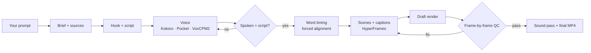

<div align="center">

# ForgeReels

### One prompt in. A finished vertical reel out. Locally, on your Mac.

**ForgeReels turns Claude Code into a video studio.** You describe the reel, and it writes the script, voices it,
times every animation to the spoken word, renders a 1080×1920 MP4 and checks every frame before you see it.

[](LICENSE)


</div>

```text
> /forge-reels Make a 30 s reel: "Why your phone steals two hours a day". Warm, punchy, English.
```

That is the whole interface. ForgeReels asks only what it is missing, then runs the pipeline end to end:
brief → sources → hook → script → voice → word timing → animation → render → sound → QC.

---

## Why ForgeReels

| | |
|---|---|
| **Free, forever** | No subscription, no credits, no per-minute fees. Voices, timing, rendering and checks run on your machine. |
| **Animations land on the word** | Word times come from forced alignment of the script itself, not a guess: **0.02 s** mean error on line starts, against **0.24 s** for plain Whisper. When the voice says "three", the counter hits 3. |
| **Real voices, English first, Dutch too** | Three local TTS engines, one flag apart. Change one line and only that line is regenerated. |
| **It checks before you look** | Spoken-vs-script check, clipped-word detection, safe-zone sheets, loudness, pace, motion and number tracing. A failing take never reaches you. |
| **Built for Apple Silicon** | MLX for the premium voice and speech recognition, CPU for the fast path, one heavy model at a time so 16 GB is enough. |
| **Gets better every video** | Every reel writes its lessons back into the skill. |

## What it makes

- **Vertical reels** for Instagram, TikTok and YouTube Shorts, with a hook in frame 0, re-hooks, a climax and a
  seamless loop.
- **Product demos** where the real interface is rebuilt and used on screen: typing, clicks, results, zooms.
- **Kinetic type, data charts and count-ups** driven by sourced numbers.
- **One-take explainer worlds**: the camera travels between story cards while a hero object hops along the narration.
- **Talking cartoon presenters** with blinks and phoneme-accurate lip-sync.
- **Screen walkthroughs** (16:9) from real screenshots, with rings, a cursor and chapters.
- **AI stills on demand**: plates, backdrops and paper-collage art through your Codex CLI.
- **Beat-synced sound**: cuts snapped to a beat grid, an original score and a voice-first mix at -14 LUFS.
- **66 named film styles** and hand-painted looks, from glass product shots to watercolour.

## Benchmarks (MacBook Air M4, 16 GB)

Measured with `scripts/bench.py` on a 30-second, 8-line script.

| Step | Time | Peak memory |
|---|---|---|
| Voice-over, English (Kokoro) | 6.4 s | 0.6 GB |
| Voice-over, Dutch (Pocket TTS) | 6.1 s | 1.0 GB |
| Re-run after editing one line | regenerates 1 of 8 lines | |
| Re-run with nothing changed | 0.1 s | |
| Word timing by script alignment | 14–16 s | 1.9 GB |
| Spoken = script check (Parakeet, MLX) | 4.4 s | 1.7 GB |
| Premium voice (VoxCPM2 8-bit, MLX), 3 lines | 14.3 s | 3.3 GB |

## How it works



Every scene reads its timing from named cues (`window.__T.w.<name>`), so re-recording the voice re-times the whole
reel with one command. Nothing is hard-timed.

## Quick start

You need a Mac (Apple Silicon recommended), [Homebrew](https://brew.sh),
[Claude Code](https://claude.com/claude-code) and about 3 GB of disk.

```bash
git clone https://github.com/LeonardSEO/ForgeReels.git
cd ForgeReels
bash setup/setup-mac.sh
```

The setup installs ffmpeg, Node and Python, creates a venv in `~/forge-reels`, installs the skill and the motion
skills it routes to, and ends with a smoke test that must print `SMOKE PASS`. Use `--minimal` for the core skills
only.

Optional extras:

```bash
sh setup/setup-voxcpm.sh   # premium voice (VoxCPM2) + Parakeet speech recognition, Apple Silicon
sh setup/setup-audio.sh    # original scores and pro sound effects
npm i -g @openai/codex && codex login   # AI still images through your Codex account
```

Then open Claude Code anywhere and type `/forge-reels` followed by what you want.

## Voices

English is the default. Dutch is fully supported: voice, word timing and checks.

| Engine | Languages | Speed on M4 | Best for |
|---|---|---|---|
| `kokoro` (default) | English, plus ES, FR, IT, PT, HI, JA, ZH | 2.5× real time | Fast, clean English narration |
| `pocket` | English, Dutch, FR, DE, PT, IT, ES | 1.5–2.4× real time | Dutch (built-in voice `daan`), voice cloning |
| `voxcpm` | 30 languages incl. Dutch | 0.3–0.7× real time | Premium: design a voice from a description, 48 kHz |

```bash
python -I scripts/pipeline/build_vo.py --lines vo/lines.txt --out vo                       # English
python -I scripts/pipeline/build_vo.py --lines vo/lines.txt --out vo --engine pocket --lang nl   # Dutch
```

Pronunciation fixes go in a `say.json` (`{"AI": "A.I."}`); captions keep the written word. Prefix a line with
`[speed=1.1]` to give a hook more punch. To choose a voice, `scripts/voice_bakeoff.py` renders the same lines in
every engine and builds a blind listening page.

## Quality gates

| Gate | What it catches |
|---|---|
| `vo_check.py` | A take that says something else than the script, drops a word or is cut off mid-word |
| `words.py --align` | Captions and animations drifting from the voice |
| `qc_reel.py` | Wrong size, codec or loudness; a black first frame; text outside the safe zone |
| `pace_check.py`, `motion_score.py`, `flow_check.py` | Still stretches, slideshow feel, weak camera motion |
| `number_check.py` | Any number on screen or in the voice without a source |

## What is inside

```text
setup/              setup-mac.sh, setup-voxcpm.sh, setup-audio.sh, pinned requirements, skill list
forge-reels/        the skill (installed into ~/.claude/skills/forge-reels)
  SKILL.md          entry point: routing table, pipeline, hard rules
  references/       voice, visual grammar, retention, sound, QC, toolchain, machine limits, film styles
  scripts/          voice engines, alignment, QC gates, render helpers, sound, image generation
  templates/        reel project, screen walkthrough, brand pack, cartoon avatar
  tests/            unit and integration tests (python -I -m unittest discover -s forge-reels/tests)
```

## Principles

- **Never fabricate.** Every number traces to a source; illustrative maths is labelled.
- **Commercial-safe by default.** Every default model and voice allows commercial use; non-commercial ones are
  marked and never used for client work.
- **Consent first.** A real person's voice or likeness only with their permission.
- **The voice leads.** Music and effects never cover a spoken word.

## FAQ

**Does it need an API key?** No. Everything runs locally. AI stills use your own Codex login.

**Windows or Linux?** No. ForgeReels is built and tuned for macOS and Claude Code only.

**How long does a reel take?** A 30-second reel needs seconds for voice and timing; the render and your review
take most of the time. The draft is checked frame by frame before you see it.

**Can I use my own voice?** Yes: record it, or clone it with Pocket TTS or VoxCPM2 from a reference clip you have
the rights to.

## Built on

[HyperFrames](https://github.com/heygen-com/hyperframes) for rendering, GSAP and Three.js for motion,
Kokoro, Pocket TTS and VoxCPM2 for voices, Parakeet, Whisper and wav2vec2 for speech, FFmpeg for media. Licences and
required notices are in [THIRD_PARTY_NOTICES.md](THIRD_PARTY_NOTICES.md).

## License

[MIT](LICENSE) © 2026 LeonardSEO
